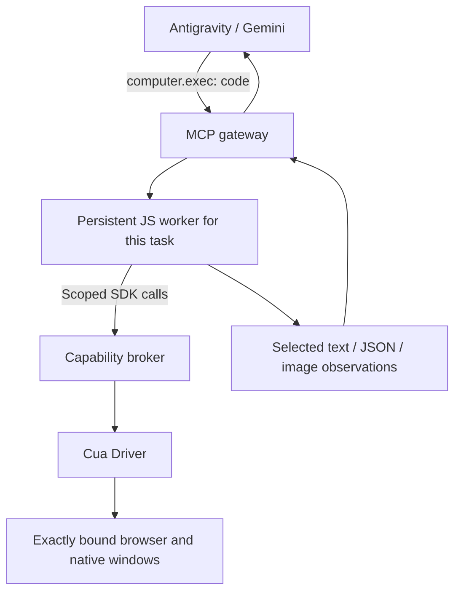

# Proposed persistent Computer Use runtime

> [!IMPORTANT]
> **Proposed fix: a persistent, programmable CUA runtime paired with a better browser observation API. Both are necessary.**
>
> The observation API must preserve useful text, links, relationships, coverage and freshness. First test the existing Driver formats; an adapter may suffice. A Driver API extension is required only if those formats cannot satisfy the contract. Implementation has not started.

Status: current architecture proposal; implementation has not started. Requested after the failed 0.4.x browsing comparisons. This supersedes the earlier optimization plan for future execution architecture. Start implementation only as a future agreed task. Keep the existing 0.4.1 repairs separate from this design work; no runtime speedup is claimed. See the [documentation guide](README.md) for the related evidence and source review.

## Decision

Replace the model-facing fixed browser-flow DSL with one programmable execution tool backed by a persistent, task-scoped JavaScript environment. Give that environment a small browser/native SDK over Cua Driver's existing authority. Pair this with a browser observation contract that preserves text, links and DOM relationships.

The decisive change is the unit of interaction: the model submits a short program and receives useful observations at a decision boundary. Local selection, bounded waits, routine branches and several known actions execute without another model turn for every primitive.

Antigravity remains the agent. The runtime has no second LLM and does not independently reinterpret the user's task.

## Evidence and limits

- The [installed-source review](CUA_SOURCE_REVIEW.md) corroborates the persistent REPL, text/image output wrappers and browser accessibility revision mechanism in the installed Codex runtime. It also separates existing Driver facilities from conditional upstream changes. No copied Codex implementation is required by this proposal.
- [The 0.4.1 validation record](VALIDATION_0_4_1.md) documents protocol/startup repairs, a successful form/native transfer, and continued public browsing failures. The latest diagnostic took 355 seconds and 25 MCP calls without inspecting a requested image; it included an operator intervention and final DOM probe.
- The user-supplied `speedup_2x_cropped_19mb.mp4` shows a Codex Chrome-integration workflow whose final UI reports 39 seconds and two inspected images. A recording demonstrates behavior; it does not establish private implementation details or a controlled performance ratio.
- The Codex interface used in this session preserved JavaScript variables and browser handles across calls. OpenAI also publicly documents an `exec_js` integration pattern, persistent execution state and in-memory image observations. That is a supported architectural pattern, not evidence that the complete Codex product backend is public. [OpenAI computer-use integration guide](https://developers.openai.com/api/docs/guides/tools-computer-use).

The latency model is approximately:

`total = model/host round-trip gaps + UI/Driver execution + readiness waits + observation/image delivery`

A persistent runtime can reduce how often model latency is paid. It cannot guarantee equal inference speed or equal total time across different models and browser setups. Counts of outer tool calls and nested Driver calls must remain separate.

## Architecture



The gateway and capability broker are trusted components. Evaluated JS runs in a separate restricted worker. Browser objects are proxies; they are not raw CDP connections or unrestricted Node objects.

A TypeScript MCP gateway using the official SDK is a reasonable production implementation. A JS worker does not need to replace the existing Driver or change its macOS permission identity. The important performance property is persistent lifetime, not changing Python RPC code to JavaScript for its own sake. Do not spawn an interpreter or reconnect the Driver on each execution.

## Model-facing surface

Expose `computer.exec` and a small lifecycle/status surface. Register the common SDK documentation once. Keep the dozens of Driver primitives behind the broker; expose diagnostic tools deliberately rather than passing the whole Driver tool list through as the normal interface.

The JS environment should provide:

- Persistent values and functions, top-level await, predictable redeclaration behavior and explicit reset epochs.
- Browser/tab and native-app/window handles that survive successive executions within a task.
- Read/locate/click/type/wait/screenshot methods, plus the existing native batch/script facilities.
- `emit.text`, `emit.json` and `emit.image` for deliberate outputs. Preserve full observations locally; return only the needed evidence to the model.

Do not implement persistence by wrapping every submission in a new async function and losing its variables. Verify actual REPL semantics in the first spike.

Illustrative orchestration, not an existing API:

```js
// Execution 1: establish state and return useful linked observations.
var tab = await computer.browser.open({ profile: "isolated_new" });
await tab.goto(startUrl);
var dom = await tab.readDOM();
emit.json(dom.describe());

// Execution 2: the selector comes from the observed structure above.
var cards = dom.queryAll(observedCardSelector);
var candidates = cards.filter(card => /One Piece/i.test(card.textContent));
emit.json(candidates.map(card => ({
  text: card.textContent,
  links: card.queryAll("a[href]").map(a => ({ text: a.textContent, href: a.href }))
})));
```

Those second-execution filters require no browser read. Once the next action is known, one execution can navigate, await the required state, capture the requested observations and emit them together. The model still decides unknown branches and interprets images.

## Browser observation contract is a prerequisite

The JS environment needs an immutable observation containing, where applicable:

- Exact target/tab identity, document/frame generation and observation revision.
- Nodes with parent/child relationships, rendered text, accessible name/role, href and relevant attributes.
- Actual Driver-minted action refs, visibility and coordinate provenance.
- Scope, complete/omitted information and valid pagination/continuation metadata.

A title in one static-text node must remain associated with its containing card and descendant link. Do not infer that association from flat row adjacency, sequential ref numbers or matching list positions.

First run a contract test on the actual catalog using the existing typed `dom_refs_v1` and `semantic_v2` data. The earlier DOM diagnostic ran after navigation into the thread, so it did not establish whether catalog title/link association is available. Preserve the original structured data before projecting it for model output.

If the existing data is sufficient, build the adapter around it. If the data is insufficient, add a small typed, read-only DOM observation/query capability to Cua Driver under its existing target/tab/session authorization. A REPL cannot recover relationships the backend never returned. Do not make raw CDP or weaker legacy `page` targeting the hidden default just to make the benchmark pass.

Retain a graph or indexed observation in runtime memory. A model-output text limit must not silently become a data-retention limit. Bounded reads should expose explicit coverage. Consume opaque continuations according to Driver freshness rules; if later reads invalidate earlier action refs, retain those older nodes as historical content and resolve a fresh locator before acting.

Use Driver's existing native incremental observations. For browser observations, begin with retained structured state and deliberate output; a local comparison can reduce model payload without reducing backend snapshot cost. Driver-side browser revisions or events are a separate optimization, justified only by measured acquisition/serialization cost. WebAssembly is one implementation choice, not a prerequisite for persistence or incremental output.

## Freshness and readiness

Persistent data is not automatically current UI state. Locator objects are recipes to resolve against fresh state; snapshot refs remain tied to their original observation. Navigation, tab changes and mutations invalidate actionable caches as required by the Driver.

Put routine waits in the SDK: navigation readiness, visible/enabled controls, changed search results and final postconditions. The public catalog test showed that even keyboard input could be followed by a read before filtering settled. These waits should observe a specific condition with a deadline, cancellation and call budget. Prefer a narrow DOM condition or event-driven observation to repeated full AX scans where the backend supports it.

Retry observation, not an uncertain mutation. A timeout after input or click must report completed and in-flight work. It must not replay that action automatically.

## Authority, isolation and lifetime

- The broker owns Cua session names, target handles, allowlists and authorization metadata. Evaluated code cannot replace them or choose another task's session. Forward the current execution request's MCP metadata; never reuse a previous request's capabilities.
- Use a trusted host task/conversation identity if Antigravity supplies one. An MCP connection may serve several chats; a model-selected label is not verified conversation identity. Until the host contract is verified, call the isolation per-task and use opaque, non-enumerable context capabilities. Do not derive authority from workspace paths or CLI session-cache files.
- A JS context alone is not an isolation boundary. Run evaluated code in a restricted process/runtime with no unrestricted filesystem, module, process or network access. Expose only the intended asynchronous capabilities. Keep credentials and raw Driver metadata out of user-code globals.
- Serialize conflicting actions on a shared UI resource. Context A cannot use context B's handles. Reset creates a new epoch so old handles fail explicitly.
- Persistent variables may survive executions; detached UI activity must not. Track and stop pending operations on cancellation. If an operation may already have executed, retain its journal/outcome in the broker even if the JS worker is terminated.
- Task end releases only task-owned browsers, snapshots and workers. It does not terminate the shared Driver or close user-owned native documents.

The official MCP SDK provides request cancellation signals and protocol handling, but application-owned execution isolation/lifetime still need implementation. [Cancellation documentation](https://github.com/modelcontextprotocol/typescript-sdk/blob/main/docs/servers/logging-progress-cancellation.md).

## Images are an integration gate

Keep captures in memory and emit genuine MCP image content with dimensions, capture/coordinate metadata and a short caption. Do not print base64 into text or make a filesystem path the normal perception route. The MCP format supports mixed text and image output. [MCP tool content documentation](https://github.com/modelcontextprotocol/typescript-sdk/blob/main/docs/servers/tools.md).

Verify actual Antigravity model access: return two synthetic images with codes absent from all accompanying text, and require the model to read both without another image-file read. A visible image card is not sufficient evidence. If the host does not deliver those images to Gemini vision, record that as a host integration blocker; a persistent interpreter cannot fix it by itself. Bundle already-selected images into one response when appropriate so their inspection need not require separate model turns.

## First implementation slice and acceptance

1. **Contract spike:** prove title-to-link association on a catalog, and prove model-visible inline images. These decide whether the missing work is an adapter or a Driver/host capability.
2. **Minimal executor:** one task worker, persistent values/functions, one browser handle, one exec schema, actual Cua authority, safe reset/end and cancellation. Prove repeated local filtering adds zero Driver calls.
3. **Representative workflow:** use a deterministic catalog fixture with titles and unnamed links in different descendants, delayed keyboard-triggered filtering, later replies and two images. Complete it through Antigravity, then transfer a live synthetic value to an exact native window.
4. **Matched live comparison:** same Gemini model/settings, host, Driver, prompt, profile mode and initial state. Run the baseline and candidate separately, then use Codex as a separately attributed reference. Follow the existing live comparison workflow.

Proposed release gates:

- Three consecutive complete representative runs with verified opening/later-reply coverage, both images inspected and cleanup verified.
- At most eight normal-path model/tool execution round trips for that fixture, including discovery; one bootstrap/schema load. This is a target to validate, not a measured result.
- No new Driver calls for local filtering of already-held observations; no repeated bindings without a justified state change.
- No additional file-reader calls for normal image perception, or an explicitly documented host limitation that prevents accepting this criterion.
- Separate discovery, outer exec, nested Driver, image, wait/retry, model/host gap and total wall-time measurements. Fewer outer calls may be useful even if a bounded readiness wait performs additional cheap reads; do not hide those reads.
- Compare timing only after equal outcome coverage passes. A five-minute failure is a timeout/failure baseline, not a valid speedup denominator. Do not promise the recording's 39-second result on Gemini.
- Isolation, stale handles, partial observations, consent refusal, cancellation after possibly completed mutation and worker reset have meaningful regression coverage.

When this slice passes, make the JS SDK the primary skill route and retire `browser_flow` as the normal interface. The architecture earns that change through a complete measured workflow, not by adding another cache or making a long sequence look like one outer call.

## Open host questions

Antigravity documentation describes persistent sidecar processes, but the documentation lookup did not establish a trusted per-request conversation identifier or guarantee that MCP image blocks reach Gemini directly. Verify those host integration facts rather than assuming them. A separate sidecar is optional; the MCP server can initially own worker lifetime. [Antigravity sidecars](https://antigravity.google/docs/sidecars).
